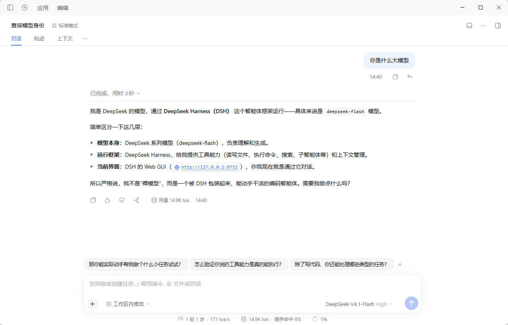

# dsh-suggestion-chips

DSH(DeepSeek Harness 0.2.x)插件:AI 回复结束后,在**消息输入框上方**显示几条建议追问 chips。



- **单击** chip:把建议文本填入输入框(替换当前草稿),可继续编辑;填入不算"打字",行保持显示,双击不受影响
- **双击** chip:填入后直接发送给 AI(可在设置页关闭,关闭后双击等同单击)
- 出现/消失带过渡动画:chips 逐个上场(升起+缩放+淡入),退出为纯渐隐
- 开始打字时整行自动隐藏(设置页可关);发送或新回复后自动替换上一轮建议
- 生成失败时静默跳过(界面零打扰),下一个回合自动再试;Agent/工具调用回合同样会出建议
- **键盘快捷键**(可关):↑ 激活选择、←→↑↓ 移动(跨行循环)、Enter 填入高亮 chip(草稿已是该 chip 时再按 = 确认发送)、Ctrl+Enter 直接发送、Esc 退出;鼠标点选会同步选中态
- **采纳记忆**:本地记录你对建议的采纳与忽略,汇总后反馈进生成提示词——越用越贴合你的习惯;设置页可一键清空
- **重开会话恢复建议**:建议与反馈持久化在 `~/.dsh/storages/dsh-suggestion-chips/memory.json`(仅存本机,保留 30 天/400 条),重开时缓存命中就秒出;未命中(如刚清空过缓存、超过 30 天)会静默生成一次并重新缓存
- DSH 设置页有「建议追问」分区:启用开关、条数、双击发送、打字隐藏、键盘快捷键、清空记忆,改动**即时生效**(持久化到 `~/.dsh/storages/dsh-suggestion-chips/settings.json`,优先生效于 yaml 配置)

基于 [jabingu/dsh-reply-suggestions](https://github.com/jabingu/dsh-reply-suggestions) 的宿主架构精简而来(去掉了用量/价格统计),渲染层参考了 [Anionex/dsh-suggested-replies](https://github.com/Anionex/dsh-suggested-replies) 的 `conversation.input.dock` 插槽布局,均遵循 MIT 许可(见 LICENSE)。

## 安装(desktop 桌面版)

```sh
dsh plugin --profile desktop add dsh-suggestion-chips-<版本>.tgz
```

装完后**完全退出并重启 DSH Desktop**。也可以直接装目录:`dsh plugin --profile desktop add <本目录绝对路径>`(pnpm 会以 link 方式链接,开发迭代方便)。

已发布 GitHub Release,直接安装**永久链接**即可(始终指向最新版,与工作区目录解耦):

```sh
dsh plugin --profile desktop add https://github.com/HelloDevin/dsh-suggestion-chips/releases/latest/download/dsh-suggestion-chips.tgz
```

插件发布新版本后,**重新执行上面同一条命令**即可完成更新(链接不变)。

## 配置

以下键可在 profile 的 `cordis.patch.yml`(或 overlay)中覆盖;带 * 的也可在设置页改(设置页的值持久化且优先生效):

| 键 | 默认 | 说明 |
|---|---|---|
| `enabled` * | `true` | 总开关;关闭后不再调用辅助模型 |
| `doubleClickSend` * | `true` | 双击直接发送;`false` 时双击仅填入 |
| `hideWhenTyping` * | `true` | 草稿非空时隐藏整行 chips |
| `count` * | `3` | 每轮建议条数,1-4 |
| `contextTurns` | `3` | 参与生成的最近对话轮数,1-4(最新一轮完整、历史轮减半压缩) |
| `timeoutMs` | `20000` | 辅助调用超时,1000-60000 |
| `provider` / `model` | 未设置 | 可选:显式指定辅助调用 provider/model;省略时跟随当前会话模型 |

## 模型调用与成本

每个回复轮次结束后会额外调用一次辅助模型生成建议(默认沿用回答所用 provider/model,DeepSeek 自动关闭深度思考,输出上限约 `96×count+60` token)。上下文为最近 `contextTurns` 轮的最新一轮 user≤400/回答≤1200 字符、历史轮减半,代码块以 `[代码略]` 占位。

## 工作原理

- 客户端注册 `conversation.input.dock` 插槽(composer 卡片上方的官方停靠区),宽度实测对齐输入卡片
- 回合结束检测:遍历会话节点,取最近 `contextTurns` 轮 assistant 节点(**含工具调用回合**,工具名序列压缩后一并传入)
- 建议生成:客户端经 Typert RPC 调用宿主服务,宿主用 `ctx.llm.stream` 请求 JSON 数组并解析清洗(去围栏/引号、单行、去重、截断)
- 设置与记忆:`chipSettings`/`applyChipSettings`/`recordFeedback` RPC,宿主原子写 `storages/<pkg>/settings.json` 与 `memory.json`
- 发送:调用宿主 `inputActions.setDraft()` / `inputActions.submit()` 原生路径

## 卸载

```sh
dsh plugin --profile desktop remove dsh-suggestion-chips
```

或桌面端「插件」页移除,然后重启 DSH。
